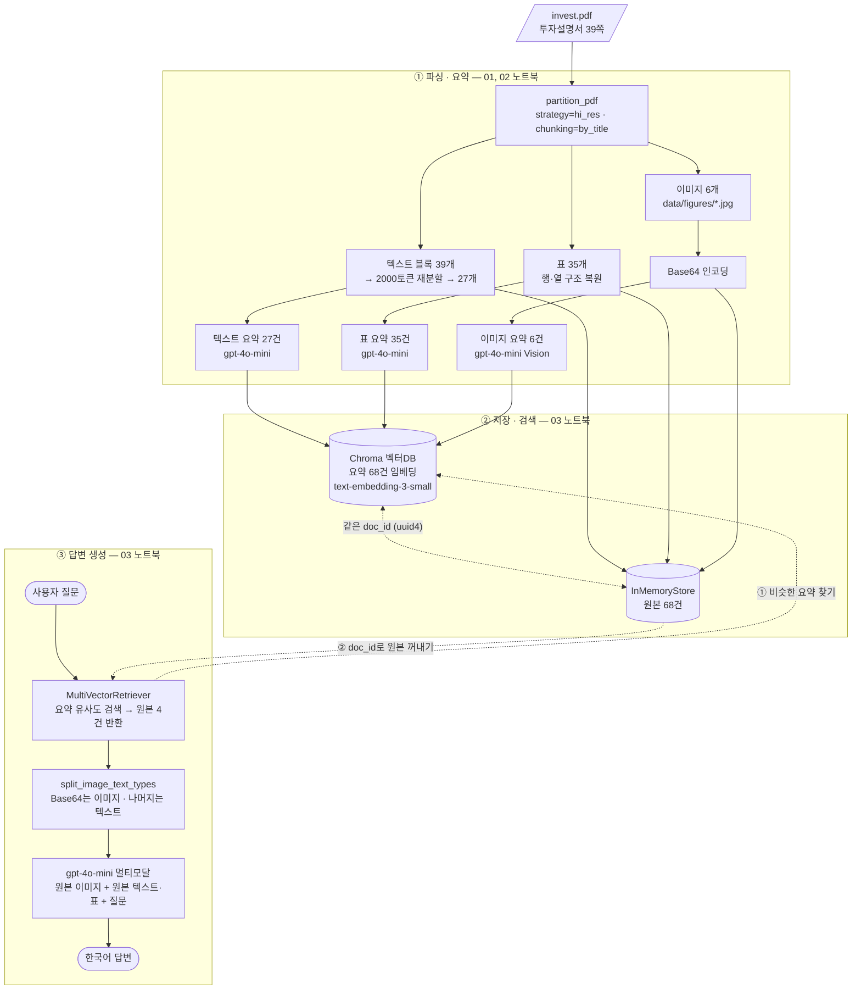

# 멀티모달 RAG 시스템

PDF의 **텍스트·표·이미지**를 따로 추출해서 각각 요약하고, **요약으로 검색한 뒤 원본으로 답변을 생성**하는 멀티모달 RAG 프로젝트입니다.

> 일반 RAG가 글자만 읽는 사서라면, 멀티모달 RAG는 그림과 표도 볼 줄 아는 사서입니다.

## 문제 정의

이 프로젝트에서 다룬 문서는 KOSPI200 지수를 기초자산으로 하는 투자설명서(`invest.pdf`, 39쪽)입니다. 투자자가 꼭 알아야 할 정보 상당수가 **본문 글이 아니라 표와 그림 안에** 들어 있습니다.


텍스트만 읽는 일반 RAG는 이런 정보를 검색 대상에서 놓칩니다. <br/> 실제로 "상환 차수별 횟수와 빈도율은?"이라고 물었을 때, 텍스트 전용 RAG는 **자료에 정보가 없다**고 답했습니다. <br/> 같은 질문에 멀티모달 RAG는 그림을 찾아 **1차 5,009회**라고 정확히 답했습니다. 아래 [Before/After 비교](#before텍스트rag--after멀티모달rag-비교)에 결과를 정리했습니다.

**해결하려는 문제:** 표와 그림에만 있는 정보까지 검색하고, 그 원본을 근거로 답하는 질의응답 시스템을 만드는 것입니다.

## 일반 RAG vs 멀티모달 RAG

| 구분 | 일반 RAG | 멀티모달 RAG |
|---|---|---|
| 검색 대상 | 텍스트만 | 텍스트 + 이미지 + 표 |
| 버려지는 데이터 | 그래프, 사진, 표 구조 | 없음 |
| 답변 근거 | 텍스트 청크 | 텍스트 청크 + 원본 이미지 + 원본 표 |
| 필요한 모델 | LLM | LLM + VLM(비전 모델) |
| 이 문서에서 결과 | 그림 속 상환 빈도를 물으면 "정보 없음" | 그림을 찾아 97.21%로 정확히 답변 |

### 멀티모달 RAG를 쓰는 이유

1. **정보 손실이 없다.** 투자설명서처럼 핵심 수치가 표와 그래프에 있는 문서는 텍스트만 추출하면 답할 근거 자체가 사라집니다.
2. **이미지도 검색할 수 있다.** 이미지는 그대로는 임베딩해서 검색하기 어렵습니다. VLM으로 텍스트 요약을 만들면 질문과 비교해 찾을 수 있습니다.
3. **답변은 원본으로 정확하게 만든다.** 검색은 요약으로 하지만, 답변을 만들 때는 원본 표와 이미지를 LLM에 넘겨서 요약 과정에서 빠진 세부 수치까지 활용합니다.
4. **근거를 확인할 수 있다.** 답변마다 어떤 종류의 원본(이미지/표/텍스트)을 근거로 했는지 확인할 수 있습니다. 아래 [질의응답 5건](#질의응답-5건)에서 질문별로 정리했습니다.

## 아키텍처



> 실선: 데이터 흐름 (요약은 벡터DB로, 원본은 docstore로) · 점선: 질문이 들어왔을 때의 검색 흐름

1. **파싱·요약**: `partition_pdf()`로 PDF를 텍스트·표·이미지로 나눈 뒤, 텍스트와 표는 LLM으로, 이미지는 Base64로 바꿔 VLM으로 요약합니다.
2. **저장과 검색**: 요약 68건은 Chroma에 임베딩하고, 원본 68건은 InMemoryStore에 같은 `doc_id`로 저장합니다. 검색은 요약으로 하고, 결과는 그 `doc_id`로 꺼낸 원본입니다.
3. **답변 생성**: 검색된 원본을 Base64 이미지와 텍스트로 나누고, 둘 다 멀티모달 LLM에 넘겨 답변을 만듭니다.

**왜 이미지를 요약하나요?** 이미지는 그대로는 검색할 수 없습니다. 텍스트 요약으로 바꿔야 임베딩해서 검색할 수 있습니다.

**요약만 LLM에 주면 안 되나요?** 요약하면 디테일이 사라집니다. 그래서 검색에는 요약을 쓰고, 답변 생성에는 원본을 씁니다.

## 기술 선택 근거

| 구분 | 선택 | 이유 |
|---|---|---|
| **PDF 파싱** | `partition_pdf(strategy="hi_res")` | 이 문서는 상환 조건·일정이 표로, 상환 빈도가 그래프로 들어 있습니다. 글자만 읽는 `fast` 전략은 표가 줄글로 뭉개지고 그래프는 버려지므로, 레이아웃 모델로 표·그림 영역을 찾는 `hi_res`를 썼습니다. 대신 파싱에 약 169초가 걸립니다. |
| **표 구조** | `infer_table_structure=True` | "2차 평가일에 몇 %를 받나요?"처럼 행과 열을 짚어야 하는 질문이 많아서, 표를 HTML 구조로 복원했습니다. |
| **텍스트 분할** | 청크 2000토큰 · 겹침 200토큰 (`tiktoken` 기준) | 투자설명서는 한 조항이 길게 이어지는 경우가 많아서, 조항이 중간에 끊기지 않을 만큼 크게 잡았습니다. 경계에 걸린 문장이 한쪽에는 온전히 남도록 10%를 겹쳤습니다. 한글은 글자 수와 토큰 수 차이가 커서 글자가 아니라 토큰 기준으로 잘랐습니다. |
| **요약 · 답변 모델** | `gpt-4o-mini` (temperature 0) | 텍스트·표·이미지 요약과 최종 답변을 한 모델로 처리할 수 있고(비전 지원), 요약 68건을 만들기에 비용이 부담되지 않습니다. 수치를 그대로 옮겨야 하는 문서라 temperature는 0으로 고정했습니다. |
| **임베딩** | `text-embedding-3-small` | 검색 대상이 요약 68건으로 많지 않아 작은 모델로도 충분하고, 비용과 속도가 유리합니다. Before/After 비교의 공정성을 위해 텍스트 전용 RAG에도 같은 모델을 썼습니다. |
| **프롬프트 언어** | 텍스트·표는 한국어 지시, 이미지는 짧은 지시 + **자세한 묘사** | 텍스트·표 요약은 한국어 프롬프트로도 결과가 안정적이었습니다. 이미지는 영어 지시문("검색용으로 간결하게 요약, 한국어로 작성")을 의도했지만, 노트북 코드에서 이 프롬프트가 전달되지 않고 짧은 지시만 들어가 모델이 이미지를 한국어로 자세히 묘사했습니다. 영어 지시문이 제대로 들어가도록 고쳐 다시 실행해 보니, **"간결하게"라는 지시 때문에 표 이미지 속 수치(1차 5009회, 97.21%)가 요약에서 빠지고 검색에 실패**했습니다. 그래서 수치가 핵심인 이 문서에서는 자세한 묘사 쪽이 검색에 더 유리하다고 판단해 그 결과를 유지했습니다. 요약과 질문의 언어가 같아야 임베딩 검색이 잘 맞으므로 출력은 모두 한국어입니다. |
| **동시 요청 수** | `max_concurrency=2` | 표 35건을 한꺼번에 요약할 때 요청 제한(RateLimit)에 걸리지 않도록 교안 기본값 5에서 2로 낮췄습니다. |
| **저장소** | Chroma + InMemoryStore | 실습 규모에서 설치 없이 바로 쓸 수 있습니다. 대신 커널을 끄면 사라집니다([한계](#한계) 참고). |

## 프로젝트 구조

```
multimodal-rag/
├── .env.example            # 필요한 환경변수 템플릿 (.env는 Git 제외)
├── requirements.txt        # 의존성 목록 (사람이 관리)
├── requirements.lock.txt   # 버전 고정 목록 (기계가 재현)
├── assets/
│   └── before_after.png    # Before/After 비교 캡처
├── data/                   # (Git 제외)
│   ├── invest.pdf          # 원본 PDF
│   ├── figures/            # 추출된 이미지 6개
│   └── processed/          # 단계별 결과 (extracted.pkl, summaries.pkl)
├── notebooks/
│   ├── 01_데이터추출__연습본.ipynb       # ① 파싱·텍스트 분할
│   ├── 02_요약생성_학습.ipynb            # ① 텍스트·표·이미지 요약
│   └── 03_임베딩_최종체인_연습.ipynb     # ②③ 검색기·최종 체인·Before/After·질의응답
└── src/
    ├── extract.py          # PDF 파싱
    ├── summarize.py        # 요약 체인
    └── retriever.py        # 다중 벡터 검색기
```

## Before(텍스트RAG) / After(멀티모달RAG) 비교


텍스트 RAG에는 질문 내용이 포함되지 않아 LLM이 모른다고 답변하였지만,
멀티모달RAG는 표, 이미지에서 찾아 답변을 생성해 주었다.

## 질의응답 5건

| # | 질문 | 답변 | 근거가 된 원본 종류 |
|---|---|---|---|
| 1 | 과거 20년 시뮬레이션에서 1차 자동조기상환으로 상환된 비율은 몇 %인가요? | 자료에 1차 자동조기상환 비율 정보가 없어 알 수 없다고 답변 | 이미지, 표/텍스트 |
| 2 | 2차 자동조기상환평가일은 언제이고, 조건을 충족하면 액면금액의 몇 %를 받나요? | 2027년 11월 12일이며, 조건 충족 시 액면금액의 106.10%를 받습니다. | 표/텍스트 |
| 3 | 만기평가가격이 최초기준가격의 80% 미만이면 만기에 얼마를 돌려받나요? | 액면금액의 100.00%를 지급받습니다. | 표/텍스트 |
| 4 | 중도상환을 신청하면 공정가액 결정과 대금 지급은 각각 언제 이루어지나요? | 공정가액은 신청일 익거래소영업일에 결정되고, 대금은 신청일 이후 2영업일에 지급됩니다. | 표/텍스트 |
| 5 | 이 상품에 투자할 때 원금 손실이 생길 수 있는 요인은 무엇인가요? | 예금자 보호 대상이 아닌 금융투자상품이라는 점, 약정 조건 미충족, 기초자산 가격 변동 등 | 표/텍스트 |

- 2~5번은 표와 텍스트 원본을 근거로 정확한 날짜와 비율을 답했다.
- 1번은 검색 결과에 해당 이미지가 들어 있었지만, LLM이 그림 속 수치(1차 상환 97.21%)를 읽지 못하고 모른다고 답했다.

## 한계
1. **한국어 OCR을 지정하지 않았습니다.** 파싱 때 `No languages specified, defaulting to English` 경고가 나왔고, "목 차 투 자 설 명 서"처럼 글자 사이가 벌어진 텍스트도 있었습니다. `languages=["kor", "eng"]`를 지정하면 개선될 여지가 있습니다.
2. **이미지 요약이 추측성일 때가 있습니다.** "~그래프 같습니다"처럼 단정하지 못하는 요약이 있습니다. 요약이 부정확하면 그 이미지는 검색되지 않으므로, 이미지 6건은 직접 열어 대조했습니다. 또 요약 프롬프트가 지시한 대로 전달되지 않아, 묘사 길이와 형식이 이미지마다 들쭉날쭉합니다. 프롬프트로 "표·그래프 속 수치와 항목명을 빠짐없이 포함"하도록 명시하면, 간결하면서도 검색에 필요한 수치를 놓치지 않는 요약을 만들 수 있을 것으로 봅니다.
3. **추출된 이미지 수와 PDF 속 실제 그림 수가 다릅니다.** 추출된 이미지 파일은 6개지만, 페이지를 직접 확인하면 그림과 그림으로 된 표는 7개입니다.
4. **저장소가 휘발성입니다.** Chroma와 InMemoryStore 모두 메모리에만 있어서, 커널을 다시 시작하면 색인을 처음부터 다시 만들어야 합니다. 실제 서비스라면 Chroma의 `persist_directory`나 외부 DB와, 디스크 기반 docstore로 바꿔야 합니다.
5. **처리 시간과 비용이 듭니다.** 파싱 약 169초, 텍스트·표 요약 약 62초, 이미지 요약 약 23초가 걸리고, 요약 68건과 질의마다 API 비용이 발생합니다. 문서가 길어지면 비례해서 늘어납니다.
6. **이미지 판별을 정규식에 의존합니다.** 검색 결과가 이미지인지를 "영문·숫자·`+/=`가 100자 이상 이어지는가"로 판별하므로, 긴 코드나 식별자 같은 텍스트를 이미지로 잘못 볼 수 있습니다. 메타데이터에 원본 종류를 함께 저장하는 방식이 더 안전합니다.

## 실행 방법

### 1. OS 프로그램 설치 (pip로 설치되지 않음)

| 도구 | 역할 | macOS | Windows |
|---|---|---|---|
| Poppler | PDF를 이미지로 변환 | `brew install poppler` | 압축 해제 후 `Library\bin`을 Path에 등록 |
| Tesseract | 이미지 속 글자 인식 (OCR) | `brew install tesseract` | 설치 후 설치 폴더를 Path에 등록 |

```bash
pdftoppm -v
tesseract -v
```

> Path를 등록한 뒤에는 터미널과 에디터를 완전히 껐다가 다시 켜야 합니다.
> Windows에서는 프로젝트 경로에 한글이나 공백이 있으면 파싱 단계에서 오류가 납니다.

### 2. 가상환경과 패키지 설치 (Python 3.11 또는 3.12)

```bash
python -m venv .venv
```

| 환경 | 활성화 명령 |
|---|---|
| macOS / Linux | `source .venv/bin/activate` |
| Windows PowerShell | `.venv\Scripts\Activate.ps1` |
| Windows cmd | `.venv\Scripts\activate.bat` |
| Git Bash | `source .venv/Scripts/activate` |

```bash
python -m pip install --upgrade pip
pip install -r requirements.lock.txt
```

- `requirements.txt`: 사람이 읽고 관리하는 목록 (버전 범위)
- `requirements.lock.txt`: 동작을 확인한 버전 그대로 고정한 목록 (`pip freeze`로 생성)

> PowerShell에서 스크립트 실행이 막히면 `Set-ExecutionPolicy -Scope CurrentUser RemoteSigned`를 실행하세요.
> 설치는 반드시 프롬프트 앞에 `(.venv)`가 보이는 상태에서 하세요. `unstructured[all-docs]`는 설치에 5~15분 걸립니다.

### 3. 환경변수 설정

```bash
cp .env.example .env   # 그다음 .env에 실제 OPENAI_API_KEY를 입력
```

### 4. 노트북 커널 등록과 실행

```bash
python -m ipykernel install --user --name multimodal-rag --display-name "Python (multimodal-rag)"
```

`data/` 폴더에 PDF를 넣고, VS Code에서 `notebooks/`의 노트북을 **01 → 02 → 03 순서로** 실행하세요. 커널은 **Python (multimodal-rag)**를 선택합니다. 앞 노트북이 `data/processed/`에 저장한 결과를 다음 노트북이 불러옵니다.

## 주요 패키지

| 패키지 | 역할 |
|---|---|
| `unstructured` | PDF에서 텍스트·표·이미지 요소를 분리 추출 |
| `langchain-classic` | `MultiVectorRetriever` (LangChain 1.x에서 분리됨) |
| `langchain-chroma`, `chromadb` | 요약 임베딩을 저장하는 벡터 검색 엔진 |
| `langchain-openai` | LLM / VLM 및 임베딩 |
| `langchain-ollama` | 로컬 오픈소스 모델 연동 (이번 구현에서는 미사용) |
| `pillow` | 추출 이미지 전처리 |
| `tiktoken` | 토큰 단위 텍스트 분할 |
| `python-dotenv` | `.env`에서 API 키 로딩 |
